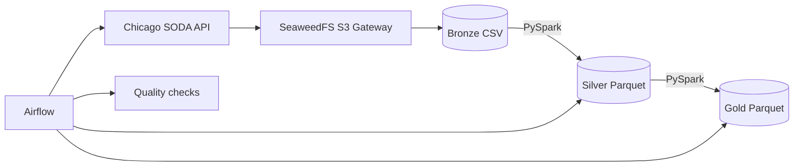

# Chicago Taxi Trips: Airflow, Spark et SeaweedFS S3

Pipeline local medaillon : Chicago SODA API -> SeaweedFS S3 Bronze -> Spark Silver -> Spark Gold, orchestre par Airflow.

## Architecture



SeaweedFS est compose de master, volume, filer et S3 gateway. Boto3 et Spark S3A utilisent le port 8333 en path-style. Les donnees sont persistantes dans des volumes Docker.

## Configuration par defaut

Periode du 1 janvier 2023 inclus au 1 fevrier 2023 exclu, pagination de 50 000 lignes, maximum 500 000 lignes. Modifier `.env` pour changer ces valeurs.

## Demarrage

```bash
cp .env.example .env
docker compose pull
docker compose build
docker compose up airflow-init
docker compose up -d
docker compose --profile test run --rm storage-smoke-test

docker compose exec airflow-scheduler
    airflow dags trigger chicago_taxi_medallion
```


## Couches

- Bronze : CSV brut, partition logique par periode et `run_id`.
- Silver : Parquet type, deduplique sur `trip_id`, valeurs negatives et identifiants absents retires, partition par `trip_date`.
- Gold : `daily_kpis`, `top_pickup_zones`, `payment_summary`.

